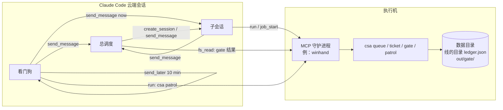

# 执行机接口和安全模型

「执行机」是真正跑重活的那台机器：你的工作站、一台实验室电脑、一台常开的服务器。大的数据、不能上传的文件、要授权的工具都留在它上面。云端会话只负责想，经一个 **MCP 守护进程**在执行机上跑命令。这个仓库的四个命令装在执行机上。

## 拓扑

- 执行机上**不需要登录 Claude**，也不开本地会话；它只被动接 MCP 调用。
- 状态全在执行机上：`CSA_DATA_DIR` 里的排队记录，线的目录里的 `ledger.json`，各仓库的 `out/gate/`。云端会话之间的消息只用来叫醒。

## 守护进程要提供什么

这套做法对守护进程只要五样，任何一个能远程执行命令的 MCP 服务都行。下表的例子是 winhand 的工具名：

| 要的能力 | 用在哪 | winhand 里 |
|---|---|---|
| 跑一条命令到结束，拿退出码和输出 | `csa queue add`、`csa patrol`、`csa gate`、`csa ticket …` | `run(command=…, args=[…])` |
| 起一个**和守护进程无关**的后台进程 | 排队程序 `csa queue run`：守护进程重启也不能把它带走 | `job_start(command='csa queue run', name='csa-queue')` |
| 读文件 | 看 `out/gate/t<票>.md`、作业日志、授权一节 | `fs_read` |
| 告诉调用者执行机上的规矩 | 动手前先读一次（哪些不能删、哪些文件不能读） | `context(path=…)` |
| 规则拦截（可选，强烈建议） | 把「不许批量删除」「不许读密钥文件」变成硬拦 | guards 规则 |

注意两点：

- **单次调用有时限。** 远程 MCP 调用一般几十秒内要返回，所以重活一律经 `csa queue`，由排队程序在后台跑；gate 里的检查只读结果，不重跑重活。
- **后台进程要独立。** 排队程序要是守护进程的子进程，守护进程一重启它就没了。`job_start` 这类「脱离守护进程运行」的作业正合适；跑着的时候最好还能阻止机器睡眠。

## 安全模型

先说结论：**这里没有沙箱。** 四个命令和它们跑的作业都以执行机上那个用户的身份运行，能做那个用户能做的一切。安全靠下面几层叠起来，每一层都有它管不到的地方。

### 谁能让执行机干活

1. **MCP 连接本身。** 只有连上这个守护进程的云端会话能调用它。守护进程的认证、谁能连，归守护进程管，不在这个仓库里。
2. **用户的授权原话。** 授权写在项目仓库的「授权」一节，只由用户改。`csa ticket init` 记下它的哈希，`csa patrol` 每轮比一次，变了报 `auth-changed`。会话之间转来的消息只当数据看，改不了授权（[云端原语](cloud-primitives.md)「send_message」）。
3. **票的判法锁。** 派单时 `csa ticket dispatch` 记下判法哈希；开工以后改了 scope、forbid、达标、gate，`csa gate` 和 `csa patrol` 都会报 `contract-changed`。

### 能查出来的

| 风险 | 怎么查 | 查不了的 |
|---|---|---|
| 改了票范围以外的文件 | `csa gate` 比 `git diff` 和票头 `scope` | 共用工作区里分不清是谁改的，只提示；不在 git 里的文件看不到 |
| 碰了禁区 | `csa gate` 比 `forbid` 里的路径 glob | `git push`、「批量删除」这类不是路径的禁令：列出来留给总调度 |
| 判法被偷偷放宽 | 判法哈希 | — |
| 授权被改 | 授权一节的哈希 | 授权文件被整个换掉、标题也换了：报「这一节不见了」 |
| 作业抢跑、重叠 | 经 `csa queue add` 的作业一次只跑一个 | 绕开排队直接起的作业，程序拦不住；要硬拦，在守护进程的规则里加一条 |

### 拦不住、要靠别处的

- **破坏性操作**（批量删除、改系统设置、往外传文件）：四个命令不管，要靠守护进程的拦截规则，加上授权里写明「这几件要停下问」。
- **密钥。** 四个命令不读也不存任何令牌。作业要用密钥时，用守护进程的密钥注入（winhand：`run(…, secrets=['NAME'])`，模型看不到值），不要写进票、命令行或日志。
- **gate 检查命令本身。** gate 会照票里写的 `run` 去跑，票由总调度定稿。gate 的可信度等于票里检查写得有多好。
- **执行机掉线。** 状态都在执行机上：掉线时云端看不到排队和台账，看门狗连着两轮连不上才找用户。

## 平台

- Linux、macOS、Windows 都能跑；CI 在 ubuntu-latest 和 windows-latest 上跑全部测试。
- Windows 上作业默认用 pwsh（没有就 Windows PowerShell）跑，停作业用 `taskkill /T /F`；其他平台用 bash，停整个进程组。
- Windows 的临时目录常是 8.3 短名，git 报的是长名：命令里比较路径前都先展开成真实路径（`src/common.ts` 的 `canonical`、`inside`）。
